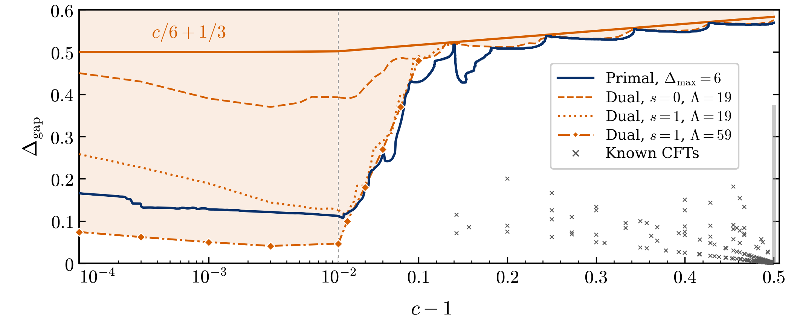

# modular-bootstrap-2d

Code and data for **"Constraining the spectral gap of 2d CFTs just above c = 1"**
(N. Benjamin, K. Langhoff, W. Li, J. Thaler; MIT-CTP/6144).

Two independent methods bound the spectral gap (the dimension
of the lightest non-vacuum scalar) of 2d CFTs as a function of the central
charge c:

- **[`primal/`](primal/README.md): search.** At each (c, gap) it tries to build
  a truncated spectrum whose torus partition function is modular invariant
  within its truncation error. Success makes the point a *candidate*. It is a
  search, so an exclusion is evidence, not proof.
- **[`dual/`](dual/README.md): proof.** Semidefinite programs on the modular
  crossing equation, at 200-digit precision, bracket the number of primaries
  in a window of dimensions. A certified bracket that contains no admissible
  whole number excludes the gap.



*Fig. 1 of the paper: the primal search boundary (blue, Delta_max = 6) and the dual bounds (orange; the solid line is the non-integral bound c/6 + 1/3 of Collier, Lin and Yin); the shaded region is excluded. Grey crosses are known CFTs. The data behind it are in [`data/paper/`](data/paper/README.md).*

Only the arbitrary-precision dual backends give certified numbers; what "certified" means, and its assumptions (twist gap, parity for spin 1, spins up to `l_check`), is spelled out in [`dual/README.md`](dual/README.md#what-is-certified).

## Install

```bash
pip install -e .                 # Python >= 3.10
pip install sdpa-multiprecision  # optional: the SDPA-GMP backend (imported as sdpap)
```

The paper's dual settings use [SDPB](https://github.com/davidsd/sdpb) through
an Apptainer image: set `SDPB_SIF=/path/to/sdpb.sif`.

## Quick start

```bash
python examples/compute_primal_point.py   # the search at two points        (~15 s)
python examples/compute_dual_bound.py     # two dual count brackets          (~20 s)
```

## Reproducing Fig. 1

| Fig. 1 element | script | cost at the paper's settings |
|---|---|---|
| primal boundary (Delta_max = 6) | `reproduce/primal_scan.py` | grid and scrub of one 20 x 20 sector: 2.8 h on 20 cores |
| one certified window count bracket | `reproduce/count_bracket.py` | spin 0: 6-20 min per side on 4 cores; spin 1: 25-70 min per bracket |
| dual curves (spin 0 and spin 1, Lambda = 19) | `reproduce/gap_bound_integrality.py` | probes x bracket cost |

Every script takes `--small`, the same pipeline at a low cutoff, which runs on
a laptop in under a minute. Settings and measured costs are in
[`reproduce/README.md`](reproduce/README.md). The numbers drawn in Fig. 1, with
the certificate behind each dual point, are in
[`data/paper/`](data/paper/README.md).

## Citation

Please cite the paper.
